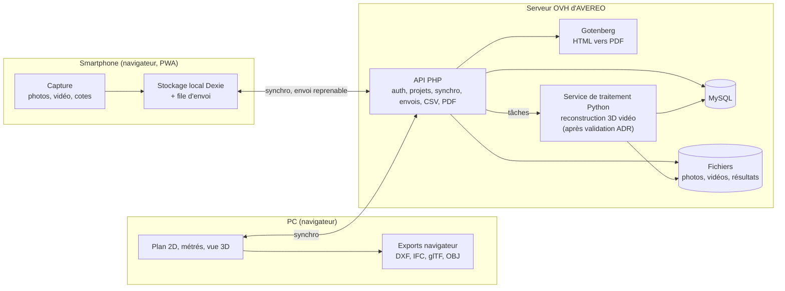

# Architecture — AVEREO Vision

Version : Lot 0 (cadrage), 23/11/2026. Proposition à valider avec l'ADR 0001 ; aucun code n'est écrit à ce stade.
Reprend les conventions de l'application Rapport (`architecture-v1/avereo-app-rapport/AGENTS.md`) : frontend React + Vite, API PHP copiée dans `dist/api` au build, configuration et secrets hors du dossier public, base MySQL dédiée avec migrations versionnées, jamais de secret exposé au navigateur.

## 1. Vue d'ensemble

## 2. Modules
| Module | Où | Rôle | Dépend de |
|---|---|---|---|
| `domain` | `frontend/src/domain/` | **Logique pure** : modèle du bâtiment, métrés, unités, mise à l'échelle, précision. Aucun import React, DOM ni réseau. Seul endroit où se calculent les métrés. | rien |
| `plan2d` | `frontend/src/features/plan2d/` | Éditeur du plan (Konva) : murs, sommets, ouvertures, cotes, annuler/rétablir. | `domain` |
| `saisie-cotes` / `capture` | `frontend/src/features/` | Écrans terrain : pièce rapide, cotes, photos, commentaires, vidéo, cotes laser. Cibles tactiles larges. | `domain`, `sync` |
| `metres-panneau` | `frontend/src/features/` | Affichage des métrés en temps réel. | `domain` |
| `maquette3d` | `frontend/src/features/` | Maquette 3D générée depuis le modèle (three.js, R3F). | `domain` |
| `exports` | `frontend/src/exports/` | DXF, IFC, glTF, OBJ générés dans le navigateur depuis le modèle. Le DXF ne dépend que de `domain` (livrable avant la 3D, lot 4) ; IFC, glTF et OBJ dépendent aussi de `maquette3d` (lots 5 et 6). | `domain` ; `maquette3d` pour IFC, glTF, OBJ |
| `sync` | `frontend/src/sync/` | Stockage local (Dexie), file d'envoi, enregistrement automatique, conflits, envoi reprenable des médias. | `domain` |
| `styles` | `frontend/src/styles/` | Jetons de la charte (voir §7), polices, composants de base. | — |
| API PHP | `frontend/public/api/` (copiée dans `dist/api` au build, comme Rapport) | Authentification, projets, synchro, envois, CSV, PDF (via Gotenberg), partage par lien, dépôt de tâches de traitement. PDO et requêtes préparées. | MySQL, Gotenberg |
| Migrations | `database/migrations/` | Schéma MySQL versionné. | — |
| Service de traitement | `service/` | Worker Python en conteneur dédié : reconstruction 3D, mise à l'échelle, export du maillage. **À mettre en place seulement après validation de l'ADR et accord du responsable.** | MySQL, fichiers |
| Gotenberg | conteneur | Convertit le HTML du dossier en PDF. | API |

Dans `docs/exigences.md`, les chemins `api/…` désignent `frontend/public/api/…`.

## 3. Flux de données : capture → modèle → métrés → exports
1. **Capture (téléphone).** Le conseiller crée un projet, une pièce, saisit les cotes (R23), prend des photos (R38), pose des commentaires (R37), filme la pièce (R14) et saisit 2 cotes laser plus 1 cote de contrôle (R17). Tout est écrit d'abord dans Dexie (R03, R04).
2. **Synchronisation.** Les modifications partent vers l'API dès que le réseau le permet ; les médias lourds passent par l'envoi reprenable (R15).
3. **Modèle.** Le modèle (bâtiment → niveaux → pièces → murs → ouvertures, plus photos, vidéos, cotes laser, annotations) est la seule vérité. Les écrans de plan et de maquette ne font que le montrer.
4. **Métrés.** La fonction pure `calculerMetres(modele)` calcule surfaces, murs, volumes à chaque modification (R27). À chaque enregistrement, l'application joint au serveur un **instantané des métrés** (`metres_snapshot`) marqué par une version de l'algorithme (`metres_version`) : le serveur n'a donc pas à refaire les calculs pour le CSV et le PDF (une seule implémentation des calculs, côté navigateur). Le serveur enregistre **dans une même transaction** la géométrie de la pièce, son instantané et `geometry_rev` (la révision de géométrie que l'instantané décrit) ; un instantané dont `geometry_rev` ne correspond pas à la géométrie reçue est rejeté et recalculé par le client, ce qui évite d'exporter des métrés d'une ancienne géométrie après un conflit.
5. **Exports.**
   - Navigateur, depuis le modèle : DXF (R43), IFC (R44), glTF (R45), OBJ (R46).
   - Serveur PHP, depuis le modèle et l'instantané : CSV (R47) ; PDF (R42) en rendant un gabarit HTML aux couleurs de la charte puis en l'envoyant à Gotenberg.
   - Test de cohérence entre écran, CSV et PDF (R48).
6. **Vidéo → reconstruction (lot ultérieur).** L'API crée une tâche ; le service lit la vidéo, reconstruit le maillage, applique l'échelle des cotes laser, contrôle la 3e cote, écrit un glTF et le statut ; l'interface propose alors le maillage (R20, R21, R41).

## 4. Modèle de données
Identifiants : UUID générés côté client (utile hors ligne). Longueurs en **millimètres entiers** (R28). Chaque objet synchronisé porte `id`, `projet_id`, `rev` (compteur propre à l'objet, pour détecter un écrasement), `updated_at`, `updated_by`, `deleted_at` (suppression logique pour la synchronisation). Un objet est supprimé pour de bon par une purge serveur, pas par le client. Le serveur attribue en plus à chaque changement reçu un `seq` croissant **par projet** : c'est le curseur de la réception (§6), distinct du `rev` de chaque objet.

| Objet | Champs principaux | Liens |
|---|---|---|
| Projet | nom, adresse (texte), client (texte libre), statut (actif, archivé), propriétaire | contient 1 bâtiment (ou plusieurs plus tard) |
| Bâtiment | nom | contient des niveaux |
| Niveau | nom, altitude_mm, ordre | contient des pièces |
| Pièce | nom, hauteur_mm, polygone (liste ordonnée de sommets x, y en mm), `metres_snapshot` (JSON), `metres_version`, `geometry_rev`, mode_capture (cotes, video, webxr) | contient murs, ouvertures, photos, vidéos, cotes laser, annotations |
| Mur | pièce, sommet_début, sommet_fin, épaisseur_mm (optionnelle, À VÉRIFIER), longueur_mm (cote saisie ou calculée), source_cote (laser, saisie, calculée) | porte des ouvertures |
| Ouverture | mur, type (porte, fenêtre), position_mm (le long du mur), largeur_mm, hauteur_mm, allège_mm (hauteur du bas) | — |
| Photo | pièce, fichier, x, y (position sur le plan, mm), date, légende | — |
| Vidéo | pièce, fichier, durée_s, date, statut d'envoi, empreinte SHA-256 | produit 0 ou 1 reconstruction |
| Cote laser | pièce, rôle (échelle_1, échelle_2, contrôle), valeur_mm, repère A, repère B (sur le croquis), image_a, image_b (images de la vidéo où l'on a désigné les extrémités, renseignées au bureau) | — |
| Annotation | cible (point, mur, pièce, photo), x, y, texte, auteur, date | — |
| Reconstruction | vidéo, statut (en attente, en cours, terminée, échouée), journal, maillage (fichier glTF), facteur_échelle, écart_contrôle_mm, état (conforme, hors tolérance) | — |
| Traitement | type, entrée (JSON), statut, tentatives, résultat, dates | reliée à une reconstruction |
| Partage | projet, jeton (hash seul stocké), expire_le, révoqué_le | — |
| Utilisateur | identité fournie par l'authentification, rôle (fondateur, conseiller ; extensible, R02) | — |

À VÉRIFIER : l'épaisseur des murs (utile pour IFC et pour les surfaces intérieures) est-elle saisie sur le terrain ou fixée par défaut ? Choix simple et réversible proposé : valeur par défaut modifiable, hors des métrés du Lot 1.

## 5. Où s'exécute chaque traitement
| Traitement | Lieu | Pourquoi |
|---|---|---|
| Métrés (surfaces, murs, volumes) | **navigateur** (`domain`) | Temps réel (R27), hors ligne, une seule implémentation |
| Mise à l'échelle par cotes laser | navigateur pour le contrôle et l'affichage ; **service** pour la mise à l'échelle du maillage | Le maillage n'existe que sur le serveur |
| Maquette 3D depuis le plan | navigateur | Interactivité |
| DXF, IFC, glTF, OBJ | navigateur | Simple, hors ligne possible, pas de transfert |
| CSV | API PHP | Lecture directe de l'instantané des métrés |
| PDF | API PHP + Gotenberg | Mise en page HTML/CSS de la charte |
| Envoi des vidéos | navigateur → API (reprenable) | Réseau mobile instable |
| Reconstruction 3D, ArUco, conversion du maillage | **service de traitement** | Calcul lourd |
| Authentification, droits, partage | API PHP | Sécurité |

## 6. Hors ligne et synchronisation
- **Stockage local** : Dexie (IndexedDB). Tables locales : les objets du §4, une **file d'envoi** (modifications non envoyées) et une **file de médias** (photos, vidéos à envoyer).
- **Enregistrement automatique** (R03) : toute modification s'écrit dans Dexie immédiatement, puis dans la file d'envoi. L'interface montre l'état « enregistré » ou « en attente d'envoi ».
- **Envoi (push)** : par lots, avec le `rev` connu de chaque objet ; le serveur attribue à chaque changement accepté un `seq` croissant du projet. **Réception (pull)** : « donne-moi tout ce qui a changé depuis le `seq` N », par projet ; le client garde le dernier `seq` reçu.
- **Conflits** (R06) : dernière modification gagnante, objet par objet, « dernière » désignant l'ordre de réception par le serveur (`seq`) et non l'horloge de l'appareil ; l'écrasement est inscrit dans un journal `sync_log` visible. Choix volontairement simple ; une fusion plus fine n'est pas prévue.
- **Suppressions** : logiques (`deleted_at`) pour qu'elles se propagent.
- **Médias** : envoyés à part, en morceaux reprenables ; le modèle référence le média par son identifiant ; tant que le média n'est pas arrivé, l'objet affiche une vignette locale.
- **Limites à vérifier** : quota de stockage et éviction du stockage sur iOS Safari et PWA installée (R04) ; une vidéo de 200 Mo peut dépasser les quotas : prévoir l'envoi immédiat dès que le réseau revient et un avertissement avant de filmer si l'espace manque.
- **Pas de synchro temps réel** (WebSocket) en V1 : interrogation à l'ouverture, au retour du réseau et toutes les 30 s environ (valeur proposée).

## 7. Jetons de la charte
- **Lieu unique de déclaration** : `frontend/src/styles/tokens.css` (variables CSS : `--brand-primary`, `--brand-accent`, `--surface`, `--surface-muted`, `--text-primary`, `--text-muted`, `--surface-corporate`, `--gris-mineral`, `--radius`). Aucun code couleur en dur ailleurs (R10, test automatique).
- **Polices** : Inter et JetBrains Mono auto-hébergées dans `frontend/public/fonts/` (aucun appel à un service de polices externe).
- **Logo** : fichiers de `docs/charte/logos/` copiés tels quels, jamais modifiés.
- **PDF** : le gabarit HTML du dossier utilise ces mêmes jetons. Un script de build copie `tokens.css` dans `dist/api/templates/` (fichier généré, non versionné) pour qu'il n'existe qu'une seule source.

## 8. Sécurité et confidentialité
- Données des relevés uniquement sur les serveurs AVEREO ; aucun service externe appelé (R08). Le conteneur de traitement n'a pas de réseau sortant (R19).
- Secrets (accès MySQL, jetons) hors du dossier public, comme Rapport ; jamais dans le navigateur ; `.env` et `local/config.php` jamais commités.
- Contrôle des droits côté PHP à chaque requête : appartenance du projet, rôle (R02).
- Liens de partage : jeton aléatoire, seul son hash est stocké, expiration et révocation (R07).
- Validation de toutes les entrées de l'API ; requêtes préparées.

## 9. Environnements et commandes
- Les commandes d'installation, de test, de build et de lancement local sont **définies au Lot 1** et inscrites dans `AGENTS.md` dans la PR du Lot 1 (consigne d'AGENTS.md). Point de départ : celles de Rapport (`npm ci`, `npm run build` dans `frontend/`).
- Aucune livraison en préproduction ni production avant décision séparée du responsable.

## 10. Points ouverts
| Point | Sort |
|---|---|
| Méthode d'authentification (reprendre celle de Rapport ou un mode plus simple) | À VÉRIFIER, à trancher au Lot 2 |
| Épaisseur des murs | valeur par défaut au Lot 1, à confirmer |
| Réutilisation de code de house-planner (MIT) | Au cas par cas, avec mention du copyright dans `docs/licences.md` |
| Décisions D1, D2, D4, D5 de l'ADR 0001 | Responsable |
