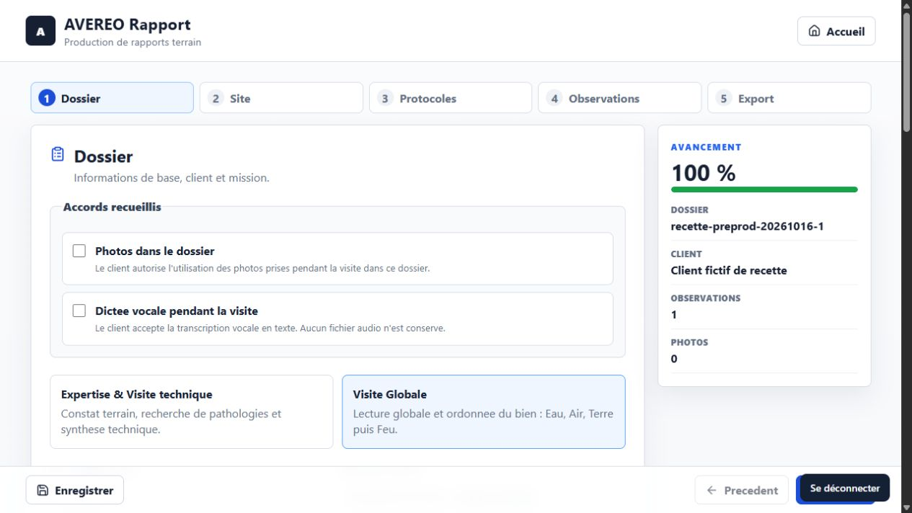

# Livraison de Rapport et Passeport Immo en préproduction

Le responsable demande le 16 octobre de livrer les dernières versions des deux
applications en préproduction, de les vérifier et de préparer leurs candidates
de production. Cette demande autorise ces livraisons de préproduction ; elle ne
constitue pas une nouvelle décision de recette, de merge ou de production.

La source de suivi est le bloc `selected_applications_delivery` du
[suivi canonique](suivi-chantier.json). Les reçus techniques sont conservés dans
`archives/livraison-rapport-passeport-20261016/`. Les archives exécutables et les
copies de récupération restent privées et ne sont pas commitées.

Revue du lot : [PR #84](https://github.com/jpdandin44/AVEREO/pull/84), fusionnée
le 16 octobre à 10:50:33 UTC ; les quatre attestations humaines sont relues sur
GitHub. L'environnement de validation est la préproduction des deux applications.
La [suite pour la production](preparation-production-rapport-passeport.md) conserve
les preuves de fusion et les prérequis restants. Les observations de livraison
ci-dessous restent datées et ne constituent pas un accord de production Rapport.

## Cadrage

Le dernier `main` observé est `d95164ea0c9863073427e82fae89e89dadeac01f`.
Rapport comporte deux choix de création : **Expertise & Visite technique** et
**Visite Globale**. Son arbre applicatif est identique à celui de la source
`3d70b530acc236f36ade6c06a553d3c9f7ed07f1` utilisée pour l'archive.

Passeport Immo utilise le même code exécutable que le candidat déjà validé
dans la décision D06 du 16 octobre. Les évolutions de la PR #83 concernent la
préparation privée de la reprise SCI et le plan CIL ; ce plan ne désigne pas une
nouvelle interface déjà implémentée. Les quinze références documentaires
approuvées restent intactes. Les données SCI et leurs documents sont conservés.

## Développement local

- Rapport : 55 tests passent et contrôle PHP du sas CONNECT réussi.
- Passeport Immo : 29 tests passent.
- Livraison ciblée : 11 tests de garde, inventaire et intégrité des deux ZIP,
  syntaxe PHP et comparaison des sources exécutables réussis.
- CI source Rapport : exécution `37506091820`, réussie.
- CI source Passeport Immo : exécution `38864545332`, réussie.

Les exécutables ont été construits précédemment à partir des sources citées ;
leur manifeste complet et leur identité avec les sources applicatives actuelles
ont été recontrôlés. Une CI source ne prouve pas à elle seule une livraison.

## Préproduction

| Application | Environnement | Archive SHA-256 |
| --- | --- | --- |
| Rapport | <https://rapport-preprod.avereo.fr/> | `6f1016bd44ce56204e2d174a927ec25c6dd5e5f9437afa337d66c704ac1b9366` |
| Passeport Immo | <https://passeport-immo-preprod.avereo.fr/> | `c44f397fd03daa433f19e6d4c72127f29e55dbf9fca679e8c7f41cc207a843cf` |

La préparation hébergée du 16 octobre à 10:09 (Paris) confirme les racines
déclarées, les configurations de préproduction et la séparation des bases.
Les fichiers et leurs permissions ont été copiés puis restaurés dans un dossier
privé ; les copies sont identiques et les fichiers actifs restent inchangés.
La sauvegarde des données Rapport couvre une table et deux rapports ; celle de
Passeport Immo couvre quatre tables et neuf documents. La relecture des fichiers
et la restauration dans des tables temporaires passent, sans changement des
données actives. Les valeurs privées ne figurent pas dans les reçus versionnés.

La livraison du 16 octobre à 10:15 (Paris) conserve neuf fichiers, en remplace
trois et en crée deux pour Rapport. Les seize fichiers Passeport Immo sont déjà
conformes : ils ont été vérifiés puis conservés sans réécriture.
Les `.htaccess` hébergés sont préservés octet pour octet, avec leurs permissions.
Les anciens assets, fichiers non prévus, configurations privées, données et
habilitations restent conservés. Aucune migration n'est requise.

La commande privée `release_selected_preprod.py apply --work DOSSIER_PRIVE`
refuse toute divergence de cible, de fichiers, de sauvegarde ou de configuration
depuis la préparation. Elle remplace chaque fichier atomiquement et publie
`index.html` en dernier. En cas d'échec, elle rétablit uniquement ses propres
écritures si leurs empreintes sont encore celles attendues. Une divergence
concurrente provoque un arrêt pour récupération manuelle, sans écrasement.

### Résultats hébergés et preuves

- [Livraison](archives/livraison-rapport-passeport-20261016/delivery.json) :
  cinq écritures Rapport, inventaire exact, anciens assets et chemins non prévus
  conservés, configurations privées inchangées.
- [Contrôles anonymes](archives/livraison-rapport-passeport-20261016/http-anonymous.json) :
  redirections attendues vers CONNECT et API privées refusées.
- [Recette HTTP initiale](archives/livraison-rapport-passeport-20261016/http-failure.json) :
  lancement CONNECT, refus du rejeu, empreinte du nouveau bundle Rapport,
  création/relecture de deux rapports fictifs, déconnexion Rapport, stockage
  Passeport Immo et téléchargement des neuf documents avec empreintes identiques.
  L'exécution s'arrête sur une ancienne attente de droits ; cet échec est conservé.
- [Complément indépendant](archives/livraison-rapport-passeport-20261016/http-completion.json) :
  déconnexion des deux sessions techniques Passeport Immo et refus API ensuite ;
  les deux rapports métier présents avant la livraison sont strictement inchangés.
- [Revue navigateur](archives/livraison-rapport-passeport-20261016/browser-verification.json) :
  deux types affichés, sauvegarde en ligne, rechargement/reprise, aperçus, exports
  JSON et Word des deux rapports fictifs. Visite Globale présente ses étapes
  Eau, Air, Terre et Feu. Le brouillon déjà présent dans le navigateur est exporté
  avant les essais puis rétabli ; son export final est identique en JSON.
  Passeport Immo affiche six documents actifs et trois archives sans modification.

La revue utilise des tickets CONNECT ordinaires, à usage unique, pour le compte
interne 1 déjà habilité. Elle ne qualifie pas une nouvelle connexion OAuth
interactive dans Chrome : la session Chrome déclarée par le responsable reste
distincte de celle du navigateur intégré. Aucun droit ni secret n'est créé.
Les exports Word sont les fichiers HTML compatibles `.doc` de l'application ;
leur contenu et les aperçus sont vérifiés, sans rendu natif dans Microsoft Word.
La dictée, les photos, les appels géographiques externes et un second réseau ne
sont pas requalifiés dans cette recette ciblée.

Deux rapports fictifs sont conservés pour la revue, avec le préfixe
`RECETTE FICTIVE` et les identifiants du reçu. Aucune suppression de
donnée métier n'est effectuée. Les exports du brouillon utilisateur, les bases,
les cookies, les tickets et les configurations privées restent exclus de Git.

### Réserve sur les habilitations

Le [relevé en lecture seule](archives/livraison-rapport-passeport-20261016/rights-observation.json)
confirme un droit Passeport Immo actif pour les comptes internes 1 et 2, révoqué
pour le compte 3. Le code CONNECT contrôle bien les droits individuels. Le test
attendait le refus du compte 2 d'après un ancien relevé : cette attente ne
correspond plus aux droits explicites actuellement enregistrés. Ce constat ne
démontre pas un contournement du contrôle d'accès. Aucun droit n'a été modifié.
**Réserve levée le 16 octobre 2026**, après [confirmation explicite du responsable](archives/livraison-rapport-passeport-20261016/rights-confirmation.json) :
le compte **famille** doit conserver **Rapport** et **Passeport Immo** en
**préproduction**. Aucun droit n’est modifié. L’échec de l’assertion fondée sur
l’ancien relevé reste conservé comme observation historique ; la confirmation
résout l’écart sur le périmètre attendu, sans transformer ce test en réussite.
Elle ne constitue ni une validation globale de phase, ni un accord de merge,
ni une nouvelle autorisation de production ou d’ouverture.

### Compte concerné identifié — 16 octobre à 11:03 (Paris)

Le [contrôle complémentaire en lecture seule](archives/livraison-rapport-passeport-20261016/rights-account-detail.json)
identifie le compte interne **2**, nommé **famille**, actif, avec le rôle
**membre** de l’organisation AVEREO. Son adresse de connexion est conservée
dans une note locale privée et communiquée au responsable ; elle n’est pas
ajoutée aux fichiers destinés à Git.

Il peut lancer **Rapport** et **Passeport Immo**. **Coupe, Projet, Thermo et Drone**
lui sont refusés. Le contrôle hébergé refuse l’administration des comptes avec
`403 ACCOUNT_ADMINISTRATION_DENIED`. Ces observations concernent CONNECT
préproduction ; elles ne qualifient pas un compte de production.

Le journal enregistre l’activation de Passeport Immo le **16 octobre à 08:59:39
(Paris)**, par **avereo_admin**, compte interne 1. Il enregistre aussi la révocation
de Coupe une seconde auparavant. L’origine de l’écart avec l’ancien relevé est
donc identifiée. Le contrôle de 11:03 précédait la confirmation humaine ; son
reçu demeure inchangé. La [confirmation ultérieure](archives/livraison-rapport-passeport-20261016/rights-confirmation.json)
clôt cette réserve en maintenant les deux accès. Aucun compte, droit, secret,
événement humain antérieur ou livrable approuvé n’est modifié.

## Mise en production

Les mêmes ZIP sont conservés dans le dossier local privé
`.local/candidates-production-20261016/`, avec leur
[manifeste de candidature](archives/livraison-rapport-passeport-20261016/candidats-production.json).
Le statut est **candidats préparés pour revue** ; la réserve sur les droits du
compte famille est levée. Les archives et leurs empreintes restent identiques. Le plan
de livraison de production doit qualifier séparément les racines, configurations,
sauvegardes et retour arrière de production. L'outil de ce lot accepte seulement
les deux racines de préproduction ; il ne permet aucun déploiement de production.

Les ZIP sont une base applicative à promouvoir, pas une instruction d'extraction
directe en production : la configuration privée et les règles d'accès propres à
chaque cible doivent être qualifiées et préservées. Les sources, manifestes des
ZIP et fichiers réellement conservés sur le serveur sont distingués dans les reçus.

Les résultats techniques ne remplacent pas la revue humaine. La décision D06 de
Passeport Immo conserve sa portée sur son candidat exact ; elle ne valide pas
Rapport. Les quinze documents approuvés de Passeport Immo restent identiques.
Le [complément de contrôle](https://github.com/jpdandin44/AVEREO/blob/chore/preprod-rapport-passeport-20261016/architecture-v1/avereo-app-passeport-immo/docs/controle-candidat-preproduction.md)
rattache cette observation au suivi de production existant, sans redémarrer de phase.
Les prochaines actions sont la revue des deux applications, puis les contrôles
des cibles et de leur récupération avant livraison. Les [contrôles de passage
après confirmation des accès](archives/livraison-rapport-passeport-20261016/production-gates-after-access-confirmation.json)
refusent encore la production : Rapport attend notamment sa revue et son accord
exact ; Passeport Immo conserve D06, mais la qualification complète de sa cible,
la récupération, le retour arrière et la reprise SCI restent dans son lot propre.
La réserve sur le compte famille n’est plus un blocage. Le [contrôle précédent](archives/livraison-rapport-passeport-20261016/production-gates.json)
est conservé comme observation datée.
Pour Passeport Immo, la préparation de production et la reprise SCI restent
dans le lot PR #83. Aucun fichier ni donnée de production n'est modifié ici.

### Reprise technique

Le dossier serveur privé du reçu contient les sauvegardes et restaurations
d'essai, les deux archives, `selection.json` et les scripts de cette livraison.
`backup_selected.php` s'appuie sur le script existant
`architecture-v1/avereo-app-passeport-immo/scripts/backup-storage.php`, copié à
côté du helper dans ce dossier privé. Il ne doit pas être publié sous une racine web.
Une vérification de fichiers peut être relancée avec
`release_selected_preprod.py verify --work DOSSIER_PRIVE`. Ne pas rejouer `apply`
sur un dossier ayant déjà son reçu de livraison. Ne pas rejouer la recette
initiale sur ses identifiants de rapports déjà utilisés : elle exige des
identifiants fictifs frais et s'arrête sur l'attente historique de droits.
Le complément termine seulement les contrôles indépendants. La réserve a ensuite
été levée par la confirmation humaine référencée ci-dessus ; l’assertion initiale
reste en échec dans son reçu historique et aucune approbation globale n’est créée.
